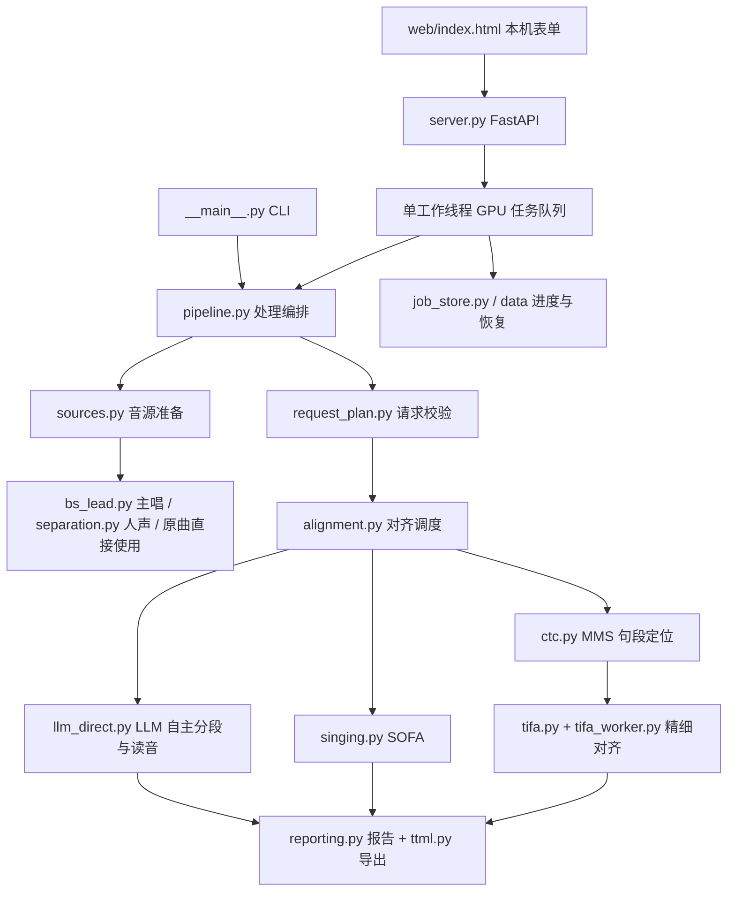

# 架构与维护边界

## 实际运行链路



LLM 可选，用于拆分文字和确认读音。`llm_splitter.py`、`audio_readings.py`、`llm_direct.py` 使用请求范围的上下文，并各自保存提示词。整曲模式一次发送完整音轨和全部歌词，由 LLM 判断每段语言、分段和读音，再经过 MMS 和 TIFA。没有自动分批或补发；无效行保留可复核的整句时间。时间不由 LLM 返回。

## 模块职责

| 层 | 文件 | 职责 |
| --- | --- | --- |
| 入口 | `web/index.html`、`web/styles.css`、`web/ui-logic.js`、`web/app.js`、`__main__.py` | 页面布局和样式、选项规则、提交 / 轮询；CLI 参数 |
| 服务 | `server.py`、`job_store.py` | 本机请求限制、上传、单 GPU 队列、状态持久化、下载 |
| 编排 | `pipeline.py`、`request_plan.py` | 处理流程编排、请求校验与计划 |
| 音源 | `sources.py`、`audio.py`、`separation.py`、`bs_lead.py` | 解码、主唱 / 人声分离、时间线保持与重建检查 |
| 对齐 | `alignment.py`、`ctc.py`、`singing.py`、`tifa.py`、`tifa_worker.py` | 各对齐路线调度、加载本地权重、映射和检查原生时间 |
| 语言与结构 | `text.py`、`numeric_lyrics.py`、`japanese_loanwords.py`、`english_syllables.py`、`tifa_pronunciation.py`、`schema.py` | 歌词、读音、显示单元及音素对应（中文为普通话拼音） |
| 报告与导出 | `reporting.py`、`ttml.py` | 复核报告、字符保留、结构 / 时间校验、AMLL TTML 编辑初稿 |
| 安装 | `安装.cmd`、`setup.ps1`、`scripts/setup_helpers.ps1`、`scripts/verify_gpu.py`、`model_catalog.py`、`scripts/download_*.py` | 工具引导、真实 CUDA 检查、五组必需模型的显式下载；运行期间不调用安装器 |

`models/`、`data/`、`.venv/`、`.runtime/` 是本机状态，不属于源代码。安装固定下载五组必需模型；缺项时按可用性报错并提示补装。SOFA 的日语音素表原来被 MMS 间接读取，现改为等价的固定音素标签表。

## 音频预处理

- `lead`（默认）：BS-Roformer 从原曲或导入轨提取主唱（去掉伴奏，并尽量去掉和声），适用于任意对齐模式。
- `vocals`：Kim MelBand 去掉伴奏、保留主唱和和声；已导入人声时直接使用导入轨。
- `source`：不改动音频，直接使用原曲或导入的原声轨。
- 导入轨必须与原曲同起点、同时长；分离失败时报错，不静默换轨。
- 背景歌词（`role=bg`）在 `lead` 模式下使用 Kim 完整人声（从原曲提取）或导入的完整人声，没有原曲回退；不能拿“原曲减主唱”的剩余轨当作纯伴唱。

## 源码目录与常用命令

```text
timing/         API、任务、编排、对齐、分离、文字处理与 TTML
web/            无构建步骤的本机表单
scripts/        显式模型安装、GPU 检查、源码发布检查
tests/          离线单元 / 协议 / 页面状态测试
dictionaries/   用户读音覆盖模板
docs/           架构、模型、使用与发布说明
```

```powershell
uv sync --frozen
.\.venv\Scripts\python.exe -X utf8 -m pytest -q
node --test tests/test_web_ui.cjs
.\.venv\Scripts\python.exe -X utf8 scripts/check_publication.py
```

Node 仅用于页面逻辑测试，应用运行不需要 Node。需要模型资源的少数测试在未安装时跳过；基础测试不请求远端 LLM。

## 已整理与保留的债务

安装固定为五组必需模型（MMS、TIFA、SOFA、BS 主唱、Kim 人声），没有可选安装配置。旧 Qwen、旧 aufr33 主唱、HubertFA 和 Anvuew 的模型及代码已删除；历史试验和单歌恢复脚本的源码备份位于本机 `.runtime/refactor61/before/`，不进入 Git。`pytest` 已从运行依赖移至开发依赖；源码版本为 0.12.0，服务接口版本为 6，页面状态检查对应接口版本 6。

目前仍是单进程应用。API 的队列防止网页任务并发占用 GPU；CLI 是独立进程，使用时不要同时启动多个 GPU 作业。任务执行中重启会中断计算，不会自动续算。

`pipeline.py` 只编排任务；请求校验、音轨准备、对齐调用和报告分别放在 `request_plan.py`、`sources.py`、`alignment.py`、`reporting.py`。API、CLI 和直接调用共用请求校验，网页用独立的 `ui-logic.js` 计算适用选项；不生效的接口参数会停用，旧版分离参数会明确报错。页面的样式、选项规则和交互脚本已从 HTML 拆开。网页的“歌曲语言”把整首语言（`mixed` / `ja` / `en` / `zh` / `zh-en`）交给后端，行级 `language`（含 `auto`）优先；只有 `zh` / `zh-en` 会把汉字按普通话处理，其余模式沿用日语读法。

LLM 整曲模式忽略整首和 JSON 行级的手选语言；`llm_direct.json` 记录每行实际返回的语言、单次请求模式和音源。中日英分段分别验证本地支持的音素，具体语言不再被整首设置限制。整曲音频保留完整时间线，600 秒读取超时与 64 MiB 编码音频上限用于长输入；接口拒绝或截断不会自动引发更多 LLM 调用。

`llm_direct.read_prompt` 管理两份独立提示词：`fine` 对应 `llm_direct.txt`（默认日语细拆），`original` 对应 `llm_direct_original.txt`（日语适度合并旧版）。两版英语均要求保持单词边界，只在词内按演唱需要拆音节，禁止跨词合并。整曲 API、网页提示词导出和 CLI 共用此选择；API 报告记录实际模板名称及哈希。模板选择只影响新请求，导入 JSON 的语言、读音和分段仍以实际内容为准。

`llm_import.py` 提供手动网页模型交接：本地 `/api/llm/prompt` 生成绑定规范化歌词行的提示词，`/api/llm/import/validate` 和任务入口校验导入 JSON。只接收指定行的原文连续分段和中日英读音，不执行外部内容。导入模式不创建 LLM 客户端或读取接口配置；`align_llm_records` 与接口模式复用原生 PFML / MMS / TIFA 对齐。错误输入在音轨分离前拒绝，已保存的报告记录来源和零次请求。哈希绑定歌词、起止、角色与父行关系，不绑定音频；LRC 最后一句未知结束以 null 表示，避免解码后总时长改变校验标识。

`singing.py` 仍同时包含 SOFA 适配和共享音素处理，后续可以继续拆分。

当前交付方式是源码 checkout，用户可双击 `安装.cmd` 或运行 `setup.ps1`。网页、词典和安装器按源码根目录寻址，尚未承诺 `pip install` wheel 后的独立资源布局，也不发布 PyPI 包。

安装入口仅使用 PowerShell 7。安装与启动共用锁，防止同时修改和使用同一环境；正在运行的网页服务会阻止正式安装，HTTP 无响应时还会检查 PID / 端口对应的进程。顺序为系统 / 驱动检查、工具、锁定的 Python 3.12 依赖、真实 CUDA 运算、模型；`-CheckOnly` 只检查并写本机日志。共享 `download_support.py` 负责 HTTP 续传、有限重试、校验和正式文件的原子替换；各模型下载器负责固定来源与配套依赖。进度 JSON 不作为跳过校验的依据。具体使用见 [安装说明](installation.md)。

TIFA 隔离依赖沿用固定的 `--no-deps` 版本清单，安装时另外检查运行库能否导入。复查本机 onnxruntime 1.31.0 的依赖元数据后，确认 `ml-dtypes` 属于 `quantization` 可选扩展；当前基础推理不因此额外安装它。这次没有改动已安装的模型依赖环境。
